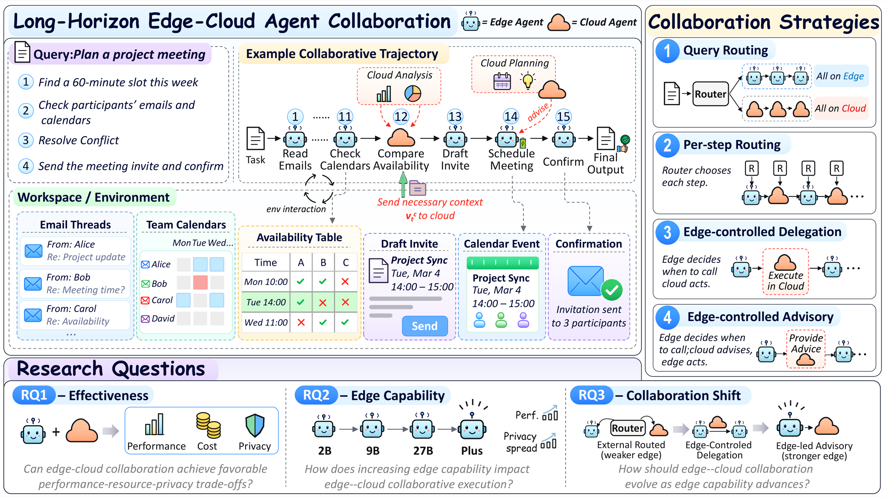
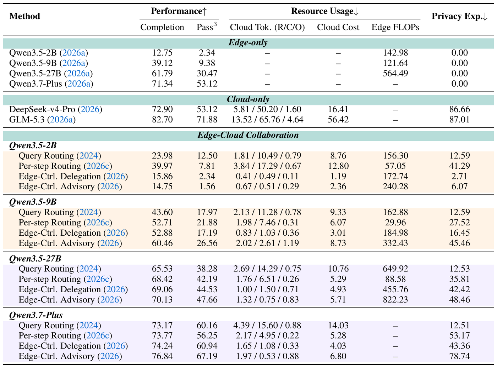
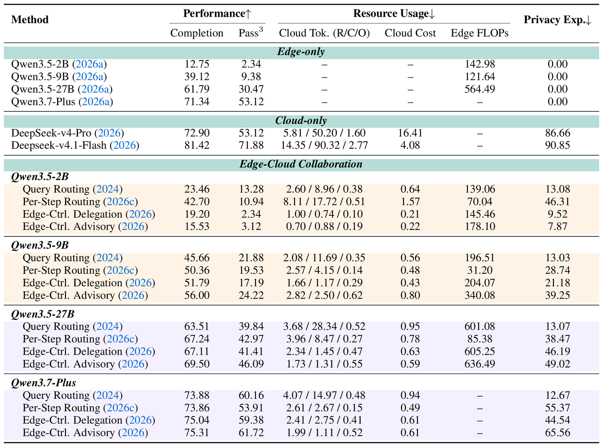

<div align="center">

# EC²-Bench

**Empowering Edge Agents: A Systematic Analysis of Edge-Cloud Collaboration in LLM Agent Execution**

[](https://passionate11.github.io/ec2-bench-project-page/)
[](https://passionate11.github.io/ec2-bench-project-page/paper.pdf)
[](LICENSE)

> 128 executable tasks · 100 privacy-annotated · 4 collaboration strategies · Task Performance · Resource Usage · Privacy Exposure



</div>

---

**EC²-Bench** (**E**dge–**C**loud **C**ollaborative Agent Benchmark) is a benchmark for **edge–cloud collaboration in long-horizon LLM agent execution**. Edge-side models keep data local and cost little but are weak at demanding planning and tool use. Cloud-hosted frontier models are far more capable, but they are expensive and see everything they are sent. Prior edge–cloud systems coordinate the two **once per query**. In long-horizon agent execution, cloud participation is instead **interleaved throughout the trajectory**. That creates trajectory-level effects: each cloud call shapes later steps, accumulates cost, and decides how much workspace information leaves the device.

EC²-Bench pairs **128 executable digital-workspace tasks** (100 with fine-grained **sensitivity annotations**) with a unified [OpenClaw](https://openclaw.ai/) execution and evaluation environment. It scores every run on three axes at once: **task performance**, **resource usage**, and **privacy exposure**. We use it to study four representative collaboration strategies across edge models of increasing capability.

### Key Findings

1. **Edge–cloud collaboration works for long-horizon agents (RQ1).** Partial cloud participation improves performance over edge-only execution at a fraction of cloud-only cost and exposure. With Qwen3.5-2B, Per-step Routing lifts completion from 12.75 to 39.97 at 22.7% of cloud-only cost, and many configurations beat a linear edge↔cloud interpolation.
2. **Stronger edges close the performance gap, not the privacy gap (RQ2).** The best collaborative configuration climbs from 39.97 (2B) to 76.84 (Qwen3.7-Plus), approaching cloud-only's 82.70. The completion gap across strategies narrows from 25.22 points (2B) to 3.67 (Qwen3.7-Plus), but privacy exposure does not converge: with Qwen3.7-Plus, strategies differ by only 3.67 points in completion but by 66.23 in privacy exposure.
3. **The best collaboration mode shifts with edge capability (RQ3).** Weak edges benefit most from external routing and direct cloud execution; stronger edges benefit more from edge-controlled invocation and cloud advisory. Two edge-side abilities underlie the shift: **deciding when to invoke the cloud** (up to +4.4 over a matched random-invocation baseline) and **following cloud guidance** (instruction-following training raises advisory completion from 24.8 to 28.8).

### Design Highlights

| | What we test | Why it matters |
| --- | --- | --- |
| 🦞 **OpenClaw-native** | The real OpenClaw agent loop (bash, browser, file ops, APIs, and reusable `SKILL.md` skills) driving a live local workspace | Tasks need long-horizon planning, state tracking, and error recovery. Cloud calls land *mid-trajectory* over accumulated workspace context, not on a static prompt |
| 🔀 **Collaboration-centric** | 4 strategies spanning *who decides* when the cloud joins (external router vs. edge agent) and *what the cloud does* (execute vs. advise) | Isolates *how* collaboration is organized from *which* models are used |
| 🔐 **Privacy exposure** | 100 tasks with 3,385 sensitivity units (personal + organizational, 12 categories); an LLM judge reaches 96.9% F1 against human labels | Every cloud invocation is a potential leakage channel, so we audit what crosses the boundary over the whole trajectory |
| ⚖️ **Multi-dimensional** | Task performance · Resource usage · Privacy exposure, reported jointly | No single number hides the trade-off |
| 📦 **Reproducible** | Each task runs in its own Docker container | Graders are injected only after the agent finishes and are never visible during execution |

---

## Tasks

**128 executable tasks** across **6 categories** (Chinese & English); **100** carry fine-grained privacy annotations. Each is a self-contained Markdown file under [`tasks/ACE_Bench/`](tasks/ACE_Bench/) containing a prompt, an inline `grade()` verifier, and a workspace path.

| Category | # | Example tasks | Core challenges |
| --- | --- | --- | --- |
| **Office & Daily Tasks** | 36 | ambiguous contact email, meeting notes, expense report, daily summary | Multi-source aggregation, clarification, structured output |
| **Information Search & Gathering** | 34 | email search, competitive intelligence, paper affiliation lookup, CRM bug hunt | Web + local data reconciliation, source verification |
| **Safety & Security** | 21 | leaked API-key detection, prompt injection, malicious skill, HIPAA/PHI referral | Adversarial robustness, credential awareness, refusal |
| **Development & Operations** | 14 | system health check, automation-failure recovery, LLM API gateway skill | Undocumented setups, debugging, skill creation |
| **Data Analysis** | 13 | order-profit analysis, month-end reconciliation, quarterly business insight | Spreadsheet reasoning, state verification |
| **Automation** | 10 | flight booking, n8n workflow report, scheduled-briefing skill | Long-horizon orchestration, recovery |

Tasks are adapted from six executable agent benchmarks: Claw-Eval (68), WildClawBench (22), QwenClawBench (21), LiveClawBench (4), PinchBench (3), and ClawBench (3). Seven more tasks were curated to cover under-represented scenarios. Every task was standardized to one runtime and evaluation interface, then filtered so that edge-only, cloud-only, and collaborative execution can meaningfully differ.

**Scoring.** Every run is graded on **three dimensions at once**:

- **Task Performance**: completion score (weighted, task-specific checks combining rule-based validation, environment-state auditing, and rubric-based LLM-as-a-judge) plus `Pass³`, the fraction of tasks with score > 0.7 in all 3 runs.
- **Resource Usage**: cloud input / cache-read / output tokens with USD cost, plus edge-side FLOPs.
- **Privacy Exposure**: the fraction of annotated sensitivity units that become visible to the cloud anywhere along the trajectory (**lower is better**).

---

## Leaderboard

Edge = **Qwen3.5-2B / 9B / 27B** and **Qwen3.7-Plus** (27B and Plus serve as proxies for future, stronger edge models); Cloud = **GLM-5.3**; judge = **GPT-5.4-mini**; averaged over 3 runs. Cloud Tok. = raw / cache-read / output (millions); Cloud Cost in USD (OpenRouter pricing); Edge FLOPs in PetaFLOPs (not reported for Qwen3.7-Plus, whose parameter count is unavailable); Completion, Pass³, and Privacy Exposure in %.

<div align="center">

</div>

<details>
<summary><b>Alternative cloud model: DeepSeek-V4.1-Flash</b> (paper Appendix A.8)</summary>

<br>

<div align="center">

</div>

</details>

---

## Quick Start

EC²-Bench runs each task in an isolated Docker container bundling the OpenClaw harness and per-task mock services.

**1. Install dependencies & load the image**

The prebuilt container image is hosted on Hugging Face as a `docker save` tarball. Hugging Face is not a Docker registry, so download it and `docker load` instead of `docker pull`:

```bash
cd EC2-Bench
conda create -n ec2bench python=3.13 -y
pip install -r requirements.txt
# download the image
hf download chengpingan/AceBench \
    Images/acebench-openclaw-v1.0.tar.gz --repo-type dataset --local-dir .

# download the workspaces (single tarball) and extract
hf download chengpingan/AceBench \
    workspace/ACE_Bench.tar.gz --repo-type dataset --local-dir .
tar -xzf workspace/ACE_Bench.tar.gz      # extracts into workspace/ACE_Bench/

docker load -i Images/acebench-openclaw-v1.0.tar.gz   # loads acebench-openclaw:v1.0 (must match DOCKER_IMAGE in .env)
```

**2. Configure keys**: copy `.env.example` to `.env` and fill in:

```bash
OPENROUTER_API_KEY=...                 # cloud collaborator (any OpenAI-compatible provider)
JUDGE_API_KEY=...                      # LLM-as-a-judge for task checks & privacy exposure
JUDGE_MODEL=gpt-5.4-mini
```

Edge / cloud model endpoints (e.g. a local vLLM server) live in [`my_api.json`](my_api.json) and are passed via `--models-config`.

**3. Prepare task assets**

```bash
bash script/prepare.sh
```

**4. Run**: pick a strategy via `--run-mode`. All strategies share one task suite:

| Strategy | `--run-mode` | Who decides when the cloud joins | What the cloud does |
| --- | --- | --- | --- |
| **Edge-only** | `local-only` | (never) | Nothing; every action comes from the edge model |
| **Cloud-only** | `cloud-only` | (always) | Generates every action; capability upper bound, highest exposure |
| **Query Routing** | `query-router` | External router, once per task (RouteLLM MF over the task instruction) | Runs the whole trajectory when the task is routed to it |
| **Per-step Routing** | `step-router` | External router, every step (edge next-token entropy, GlimpRouter-style) | Generates the routed steps |
| **Edge-Ctrl. Cloud Delegation** | *not included in this release* | Edge agent, via a delegation tool | Generates the delegated step, then hands control back |
| **Edge-Ctrl. Cloud Advisory** | `advisor` | Edge agent, via an advisor tool | Returns plans / suggestions / corrections; the edge still acts |

In all collaborative modes, the cloud receives the task instruction plus the OpenClaw execution history (previous actions, tool calls, observations). No redaction is applied, matching the paper's setting.

```bash
# Edge-only baseline
python3 eval/run_batch.py --category ACE_Bench --parallel 16 --repeat 3 \
  --edge-model vllm/Qwen/Qwen3.5-27B --models-config my_api.json \
  --output-dir output/edge_only/qwen3.5-27b

# Cloud-only baseline
python3 eval/run_batch.py --category ACE_Bench --parallel 16 --repeat 3 \
  --cloud-model your-provider/glm-5.3 --models-config my_api.json \
  --output-dir output/cloud_only/glm-5.3

# Query Routing: first materialize a task-level route table (requires `pip install "routellm[serve,eval]"`),
# calibrated to the target cloud ratio (≈15% in the paper; use --calibration-tasks-dir to calibrate on a held-out set)
python3 utils/query_router.py build --category ACE_Bench --target-cloud-ratio 0.15 \
  --edge-label Qwen3.5-27B --cloud-label glm-5.3 \
  --output utils/query_router_routes.json
python3 eval/run_batch.py --category ACE_Bench --parallel 8 --repeat 3 \
  --run-mode query-router --query-router-table utils/query_router_routes.json \
  --edge-model vllm/Qwen/Qwen3.5-27B --cloud-model your-provider/glm-5.3 \
  --models-config my_api.json \
  --output-dir output/query-routing/qwen3.5-27b_to_glm-5.3

# Per-step Routing: the entropy threshold defaults to a per-size calibrated value (1.3 for 27B, 1.7 otherwise);
# set GLIMPSE_ENTROPY_THRESHOLD=<tau> to override it and hit your target cloud-call rate
python3 eval/run_batch.py --category ACE_Bench --parallel 8 --repeat 3 \
  --run-mode step-router --no-redact \
  --edge-model vllm/Qwen/Qwen3.5-27B --cloud-model your-provider/glm-5.3 \
  --models-config my_api.json \
  --output-dir output/per-step-routing/qwen3.5-27b_to_glm-5.3

# Edge-Controlled Cloud Advisory
python3 eval/run_batch.py --category ACE_Bench --parallel 8 --repeat 3 \
  --run-mode advisor \
  --edge-model vllm/Qwen/Qwen3.5-27B --cloud-model your-provider/glm-5.3 \
  --models-config my_api.json \
  --output-dir output/edge-ctrl-advisory/qwen3.5-27b_to_glm-5.3
```

Single-task runs (`--task tasks/ACE_Bench/ACE_Bench_task_44_ambiguous_contact_email.md`), task filters (`--task-filter`), and privacy-judge timing (`--privacy-judge-mode {inline,deferred,off}`) are also supported.

<details>
<summary>Other run modes in this codebase (not evaluated in the paper)</summary>

- `pipeline-plan-executor`: the cloud drafts a task-level sketch once, and the edge executes locally.
- `on-demand`: the edge agent queries a cloud assistant through a shell helper (`ask_cloud.sh`) for guidance.
- `orchestrator-v1`: the cloud model acts as the main agent / orchestrator and dispatches work to an edge worker.

</details>

---

## Check the Results

Per-task outputs land under `output/<run>/<task_id>/...` (scores, token/cost usage, agent trace, produced files). A per-category and global summary is generated automatically once the run finishes.

Cloud costs in the paper are computed from the logged raw / cache-read / output token counts with OpenRouter prices (USD per million tokens):

| Cloud model | Input | Cache input | Output |
| --- | ---: | ---: | ---: |
| GLM-5.3 | 1.40 | 0.26 | 4.40 |
| DeepSeek-v4-Pro | 1.74 | 0.0145 | 3.48 |
| DeepSeek-V4.1-Flash | 0.15 | 0.003 | 0.60 |

The built-in price table in [`utils/grading.py`](utils/grading.py) does not cover these models yet. When you use them, compute the cost from the logged token counts with the prices above.

---

## Citation

If you find EC²-Bench useful, please cite:

```bibtex
@misc{huang2026ec2bench,
  title  = {Empowering Edge Agents: A Systematic Analysis of Edge-Cloud Collaboration in LLM Agent Execution},
  author = {Huang, Pengcheng and Liu, Zhenghao and Ren, Shixin and Yu, Shi and Yao, Sijia and Yan, Yukun and Xiao, Chaojun and Sun, Maosong},
  year   = {2026},
  url    = {https://github.com/OpenBMB/EC2-Bench}
}
```

## Acknowledgements

EC²-Bench stands on the shoulders of a remarkable open-source agent community, and we are deeply grateful for it. The **OpenClaw** harness gives us a real, full-featured agent runtime (tools, skills, and a live workspace) to build on. Our tasks and evaluation design draw inspiration and adapted material from a series of outstanding agent benchmarks: **Claw-Eval**, **WildClawBench**, **QwenClawBench**, **LiveClawBench**, **PinchBench**, and **ClawBench**. Their task curation, grading, and reproducible harness design set the bar for trustworthy agent evaluation and made the privacy-aware, edge–cloud extension in EC²-Bench possible.

## License

Released under the [MIT License](LICENSE). Adapted tasks are used under the licenses of their source benchmarks: Claw-Eval, WildClawBench, QwenClawBench, LiveClawBench, and PinchBench are MIT-licensed, and ClawBench is Apache-2.0. Attribution to the original benchmarks is preserved.
